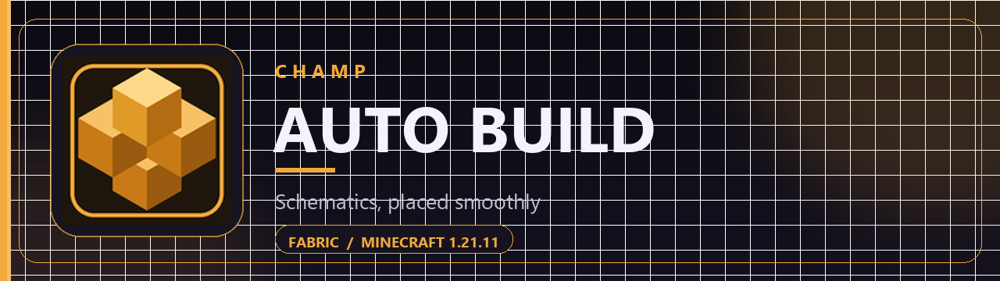
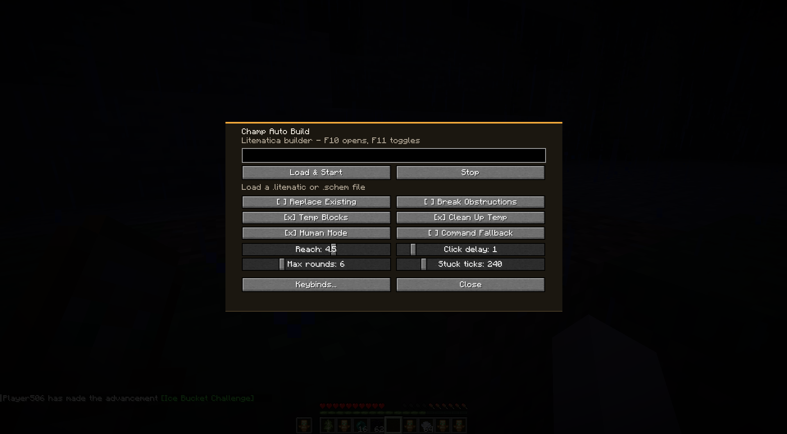

# Champ Auto Build

A **client-side Litematica and Sponge schematic builder** for **Minecraft 1.21.11** on **Fabric**, with a native Minecraft GUI.

Champ Auto Build loads a schematic and places the missing blocks using the player's own reach, line of sight and movement. It can use temporary scaffold blocks, break obstructions, retry leftovers in rounds and fall back to commands in singleplayer when you have permission. This is the standalone builder only: no auction, AI, team or restock features, no API-key code and no network services.

There is no ImGui: the interface uses normal Minecraft buttons and sliders.

## Features

- Litematica `.litematic` files.
- Sponge-style `.schem`, `.schematic` and `.nbt` files.
- `.zip` archives containing a supported schematic.
- Centres the build on the player's X/Z position and starts at the player's feet.
- Places oriented blocks, stairs, slabs, plants and water or lava buckets.
- Selects the matching item from your inventory.
- Temporary scaffold blocks with optional cleanup.
- Optional obstruction breaking.
- Optional command fallback in singleplayer with gamemaster permissions.
- Multiple retry rounds for blocks that could not be placed.
- Human Mode with smooth aiming and a configurable click delay.
- Optional Mod Menu 17.0.1 integration with a config button in the mod list.
- Built-in keybind editor with rebind and reset.
- Settings saved in `config/champ-auto-build.json`.
- Source code and a sources jar are included.

## How to use

1. Install Fabric Loader for Minecraft 1.21.11 and Fabric API.
2. Put `champ-auto-build-1.1.0.jar` in your `mods` folder.
3. Optional: add Mod Menu 17.0.1 or newer to open the settings from the mod list.
4. Put your schematic in `.minecraft/schematics/` or use an absolute path.
4. Join a world, stand where the centre of the build should start and face a clear area.
5. Press `F10`.
6. Type the file name or path. A bare name is looked up in the game directory and then in `schematics/`. If you leave off the extension, `.litematic` is added.
7. Put the required blocks and tools in your inventory.
8. Press `Load & Start`.
9. Press `Stop` or `F11` to stop. Closing the panel with `Escape` leaves the builder running.

Change the keys under `Keybinds...` in the panel, or in Minecraft's Controls screen. `Reset keys` restores F10 and F11.

The status line shows the engine state, placed count, total count and blocks left. If materials are missing, the builder waits and retries. Human Mode keeps the camera movement smooth and waits before each click; raise `Click delay` for slower placement or set it to 0 for the fastest response.

## Supported files

| Format | Extensions | Notes |
| --- | --- | --- |
| Litematica | `.litematic` | Regions, block-state palette and packed block states. |
| Sponge | `.schem`, `.schematic`, `.nbt` | Palette plus varint data or sparse block data. |
| Archive | `.zip` | The first supported schematic entry is used. |

The loader accepts up to 2,000,000 blocks. Larger files are truncated with a warning. A schematic must contain at least one placeable block.

## Options

| Option | Default | Description |
| --- | --- | --- |
| Replace Existing | Off | Replace blocks that are present but have the wrong state. |
| Break Obstructions | Off | Break blocks in the way of a target. |
| Temp Blocks | On | Use temporary scaffold blocks to reach targets. |
| Clean Up Temp | On | Remove temporary scaffold blocks after the build. |
| Human Mode | On | Turn toward targets gradually and use the click delay. |
| Command Fallback | Off | Use commands for unreachable blocks in singleplayer with permission. |
| Reach | 4.5 | Placement and breaking reach, from 2.0 to 6.0. |
| Click delay | 1 | Extra delay between clicks, from 0 to 10 ticks. |
| Max rounds | 6 | Retry rounds for leftovers, from 1 to 20. |
| Stuck ticks | 240 | Ticks before giving up on a stuck target. |

Temporary blocks use `minecraft:dirt` by default. The list can be changed in the config file through `tempMaterials`; separate multiple block IDs with commas.

## Compatibility

| | |
| --- | --- |
| Minecraft | 1.21.11 |
| Loader | Fabric Loader 0.19.0+ |
| Dependency | Fabric API |
| Optional | Mod Menu 17.0.1+ |
| Java | 21 |
| Environment | Client |
| License | MIT |

## Important notes

- Use this only on servers where automation and client mods are allowed. Many servers prohibit automation or macros.
- This is not a full Litematica replacement: it does not show holograms, save schematics or manage placements.
- It needs the actual materials in your inventory. It does not craft, trade or restock.
- It uses normal reach and line of sight. The server can reject placements, and anti-cheat or server-side limits may stop it.
- Complex block entities, entities and redstone contents are not reproduced beyond their block state.
- Floating builds may need temporary blocks, more rounds or manual help.
- The anchor is the player's position, not a saved Litematica origin. Check the area before a large build.

## Privacy and security

The mod contains no API-key handling, no tokens, no analytics and no outbound HTTP or WebSocket code. Schematic files are read from your own disk and are never uploaded. It writes only its local config file. The public GitHub repository has no collaborators and is read-only for visitors.

## License

MIT. See the repository's `LICENSE` file.
