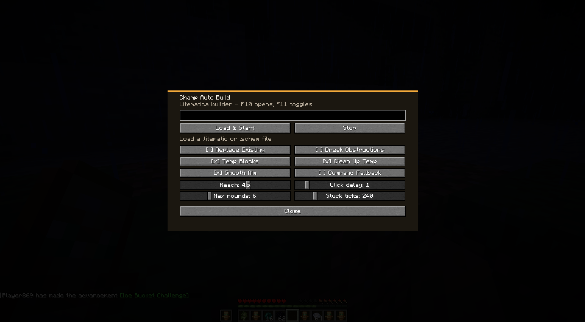

# Champ Auto Build

A client-side Litematica and Sponge schematic builder for **Minecraft 1.21.11** on **Fabric**, with a native Minecraft GUI.



Champ Auto Build loads a schematic, works out which blocks are missing, and places them using the player's own reach, line of sight and movement. It can use temporary scaffold blocks, break obstructions, retry leftover blocks in rounds and fall back to commands in singleplayer when you have permission. It is the standalone builder only: no auction, AI, team or restock features, no API keys and no network services.

## Features

- Loads Litematica `.litematic` files and Sponge-style `.schem`, `.schematic` and `.nbt` files.
- Opens `.zip` archives that contain one of those schematic files.
- Builds around the player: the schematic is centred on the player's X/Z position and starts at the player's feet.
- Places oriented blocks, stairs, slabs, plants and water or lava buckets.
- Selects the matching item from the player's inventory.
- Temporary scaffold blocks, with optional cleanup afterwards.
- Optional obstruction breaking.
- Optional command fallback in singleplayer with gamemaster permissions.
- Multiple rounds to retry blocks that could not be placed the first time.
- Human-like smooth aiming and a configurable click delay.
- Native Minecraft buttons and sliders, designed for GUI scale 2.
- Settings persist in `config/champ-auto-build.json`.

## Requirements

| Requirement | Version |
| --- | --- |
| Minecraft | 1.21.11 |
| Fabric Loader | 0.19.0 or newer |
| Fabric API | 0.141.6+1.21.11 or newer for 1.21.11 |
| Java | 21 |
| Side | Client |

## Installation

1. Install Fabric Loader for Minecraft 1.21.11.
2. Put Fabric API in your `mods` folder.
3. Put `champ-auto-build-1.0.0.jar` in the same `mods` folder.
4. Start the game with the Fabric profile.

The sources jar is for reading and building, not for the `mods` folder.

## Controls

| Key | Action |
| --- | --- |
| `F10` | Open the Auto Build panel |
| `F11` | Start or stop the builder |
| `Escape` | Close the panel without stopping the builder |

Keybinds can be changed in Minecraft's normal Controls screen under the Champ Auto Build category.

## Usage

1. Put your schematic in `.minecraft/schematics/` or use an absolute path.
2. Join a world, stand where the centre of the build should start and face a clear area.
3. Press `F10`.
4. Type the file name or path. A bare name such as `house.litematic` is looked up in the game directory and then in `schematics/`. If you leave off the extension, `.litematic` is added.
5. Put the required blocks in your inventory. Keep enough of each block and any tools you need.
6. Press `Load & Start`.
7. Press `Stop` or `F11` to stop. Closing the panel with `Escape` leaves the builder running.

The status line shows the engine state, placed count, total count and blocks left. If materials are missing, the builder waits and retries instead of failing immediately.

## Supported schematic files

| Format | Extensions | Notes |
| --- | --- | --- |
| Litematica | `.litematic` | Regions, block-state palette and packed block states. |
| Sponge | `.schem`, `.schematic`, `.nbt` | Palette plus varint data or sparse block data. |
| Archive | `.zip` | The first schematic entry in the archive is used. |

The loader accepts up to 2,000,000 blocks. Larger files are truncated with a warning. A schematic must contain at least one placeable block.

Path resolution accepts:

- an absolute path;
- a path relative to the Minecraft game directory;
- a path with a leading `~`;
- a bare file name, looked up in the game directory and then in `schematics/`.

## Options

| Option | Default | Description |
| --- | --- | --- |
| Replace Existing | Off | Replace blocks that are already present but have the wrong state. |
| Break Obstructions | Off | Break blocks that are in the way of the target. |
| Temp Blocks | On | Use temporary scaffold blocks to reach targets. |
| Clean Up Temp | On | Remove temporary scaffold blocks after the build. |
| Smooth Aim | On | Turn toward targets gradually instead of snapping. |
| Command Fallback | Off | Use commands for unreachable blocks in singleplayer with permission. |
| Reach | 4.5 | Placement and breaking reach, from 2.0 to 6.0. |
| Click delay | 1 | Extra delay between clicks, from 0 to 10 ticks. |
| Max rounds | 6 | Retry rounds for blocks that were left over, from 1 to 20. |
| Stuck ticks | 240 | Ticks before the builder gives up on a stuck target. |

Temporary blocks use `minecraft:dirt` by default. The list can be changed in the config file through `tempMaterials`; separate multiple block IDs with commas.

## Configuration file

The mod writes:

```
.minecraft/config/champ-auto-build.json
```

The file is plain JSON and stays on your computer. Deleting it restores the defaults.

## How it builds

The builder uses the schematic's block states to create a target list, skips blocks that are already correct, and then works through the remaining targets. It moves with the normal movement keys, looks at a valid face, selects the matching hotbar item, and uses the normal block interaction path. If a block cannot be reached from the current spot, it tries a nearby standing position. Temporary blocks can bridge gaps or provide a face to click. Command fallback is deliberately limited to singleplayer with the required permission level; it is off by default and is never used on a remote server.

## Important limits

- This is a client-side automation mod. Many servers prohibit automation, macros or client mods; use it only where the server rules allow it.
- It is not a full Litematica replacement. It does not preview holograms, save schematics or manage schematic placements.
- It needs the actual materials in your inventory. It does not craft, trade or restock.
- It uses the player's normal reach and line of sight. The server can still reject placements, and anti-cheat or server-side limits may stop it.
- Complex redstone, entities, block entities with contents and some modded blocks are not reproduced beyond their block state.
- A schematic that is mostly floating blocks may need temporary blocks, more rounds or manual help.
- The anchor is the player's position, not a saved Litematica origin. Check the area before starting a large build.

## Building from source

You need JDK 21. The Gradle wrapper is included.

```bash
./gradlew build
```

On Windows:

```bat
gradlew.bat build
```

The mod jar and sources jar are written to `build/libs/`:

```
champ-auto-build-1.0.0.jar
champ-auto-build-1.0.0-sources.jar
```

To run a development client:

```bash
./gradlew runClient
```

## Security and privacy

Champ Auto Build contains no API-key code, no tokens, no analytics and no outbound HTTP or WebSocket requests. The only file it writes is the local config file above. Schematic files are read from your own disk and are never uploaded. See [SECURITY.md](SECURITY.md).

The GitHub repository is public and has no collaborators, so visitors have read-only access to the upstream repository. Account security controls who can push. Forks are independent copies.

## License

MIT. See [LICENSE](LICENSE).

## Disclaimer

This project is not affiliated with Mojang, Microsoft, Fabric, Litematica or any server. Minecraft is a trademark of Microsoft. Use the mod at your own risk and follow the rules of any server you join.
